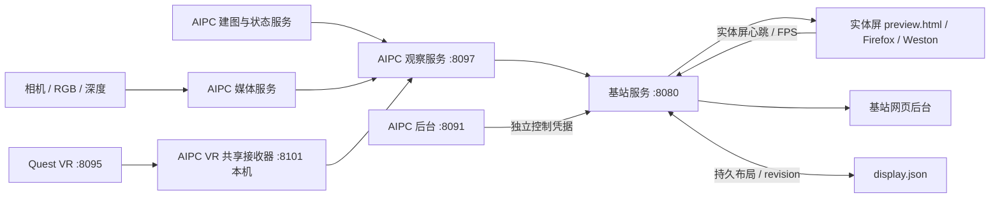

# 基站软件工作说明

交付版本：**v1.1.0**  
交付日期：**2026-11-02（北京时间）**  
版本性质：本次整理定义的交付版本；根据实际部署源码生成，不代表上游 Firefox、TLZ 或 VR 协议版本。现有基站代码未发现统一发布版本文件，本包以文件 SHA-256 标识精确源码。  
采集方式：本地电脑 → AIPC Wi-Fi SSH → 基站 SSH；已核对基站有线网卡 MAC。全程未重启、安装或修改设备服务。

## 1. 工作范围与结果

基站承担独立屏幕展示与网页管理工作，从 AIPC 获取相机、RGB/深度视频、点云、VR 直播和操作状态。VR 直接连接 AIPC，基站不再作为 VR 热点或主要数据接收端。基站展示配置可由基站后台或 AIPC 后台修改，实体屏幕读取同一份持久化布局与同一套展示 HTML。

已完成的主要功能：

| 功能 | 实现情况 |
| --- | --- |
| 登录前开机大屏 | systemd 启动专用 Wayland 会话，Weston GL 渲染，Firefox kiosk 加载本机页面 |
| 退出验证 | 独立 PAM 验证进程，通过 Unix socket 验证 apex 系统账户，授权后退出专用大屏并转登录桌面 |
| 基站网页管理 | 登录、资源指标、进程与服务信息、连接状态、视频与点云预览 |
| 同屏布局同步 | 后台与实体屏使用同一 preview.html，状态保存 display.json；revision 与实体屏心跳用于确认生效 |
| 多画面组合 | camera、depth、map、vr、camera1–4；自定义组合最多 8 个不同面板，支持六路视频同屏 |
| 新增四路相机 | AIPC 原生媒体 → 观察服务 → 基站 WebSocket → 浏览器播放器；提供兼容 JPEG 路径 |
| VR 展示 | AIPC 统一订阅 Quest，基站通过 AIPC 获取状态与 H.264/fMP4 视频；独立控制凭据用于控制操作 |
| 点云展示 | AIPC cloud 数据、WebGL 三维显示、视角参数与布局联动；基站不承担建图算法执行 |
| 断线恢复 | 状态轮询、视频 watchdog、播放器恢复、VR 重订阅与网络 DHCP 重试 |
| AIPC 后台映射 | AIPC 原生页面转发基站展示配置，只需访问 AIPC 即可设置基站大屏 |

## 2. 架构与数据链路



视频优先使用原生压缩流和浏览器解码；兼容路径可使用 JPEG/MJPEG，增加 CPU 和带宽开销。HEVC 可用性取决于浏览器、系统解码能力及源格式。代码已启用 Wayland、GL 和 VA-API 相关选项，本次没有单独进行 GPU 解码利用率或长时间性能验收，不能据配置直接宣称全部视频均硬解。

VR 采用 AIPC 共享接收而非每个基站独立拉取 Quest，避免多个订阅争抢。配置变化产生新流代次，播放器重新建立解码。最新 AIPC 源码还包含地址发现、最近成功地址记忆、预览反馈和录制相关模块；这些是配套服务能力，不等于基站已具备完整录制管理 UI。

## 3. 当前实机核对

| 项目 | 本次结果 |
| --- | --- |
| 访问路径 | AIPC 192.168.6.206 → 基站 192.168.137.131 |
| 基站身份 | hostname apex；eno1 MAC 88:ae:dd:0c:3f:5e |
| 系统内核 | 7.0.0-38-generic |
| 登录与健康 | 实际登录 HTTP 200；/api/health 返回 ok=true |
| 开机服务 | ground-display、tlz-display、tlz-kiosk-auth、tlz-display-watch、ground-legacy-entry 均 active/running 且 enabled |
| 网络恢复 | ground-network-retry.timer active/waiting 且 enabled |
| AIPC 通信 | snapshot、operator、media-status 均无错误；本次 RTT 约 2.49–7.54 ms |
| 布局同步 | 后台 revision=100，实体屏 revision=100，实体屏心跳约 98 ms |
| 当前组合 | camera1、camera2、camera3、camera4、RGB camera、VR，共六个面板 |
| RGB 与四路相机 | 实体屏上报 ready=true，约 29.66–30 FPS；这是本次状态快照，不是长期稳定性证明 |
| 深度画面 | 当前未选入布局，不能用其 waiting 状态判定上游深度相机故障 |
| VR | 当前 AIPC 接收器报告 Quest 192.168.137.115 不可达，实体屏 VR 未就绪；不得把缓存历史 FPS 当作实时画面 |

状态证据见包内 validation/live-readonly.json。完整进程命令行可能带媒体请求头，未纳入提交包；系统账户密码、运行 token、浏览器配置与 Cookie 同样不打包。

## 4. 源码结构

```text
source/ground/
  usr/local/lib/ground-display/
    server.py                 HTTP、鉴权、状态轮询、指标、流代理与接口注册
    display_state.py          布局校验、版本递增与原子持久化
    display_control_auth.py   AIPC 到基站的专用布局控制凭据
    camera_channels.py        新增四路相机 WebSocket 与兼容转发
    vr_relay_client.py        当前生效的 AIPC VR 转发接入
    network_retry.py          业务网 DHCP 恢复
    legacy_entry.py           旧 8085 入口兼容
    vr_view.py / tlzv_mp4.py   保留的早期接入实现，不是当前 VR 主入口
    public/                   后台、大屏、布局同步、播放器、点云与统一样式
  usr/local/lib/tlz-kiosk/
    session.py / firefox.py   专用 Wayland 与 kiosk 生命周期
    auth.py / watch.py        PAM 验证与大屏守护
  etc/systemd/system/         已部署的服务、定时器与 drop-in
  etc/pam.d/                  采集到的 PAM 会话/验证配置
source/aipc-companion/
  usr/local/lib/tlz-ground-observer/  当前观察服务、四相机桥接、VR 桥接
  usr/local/lib/aipc-vr-live/         当前 VR 接收、地址发现、媒体封装与反馈模块
  home/apex/md-service/              基站配置映射 API 和页面模块
config-examples/              脱敏配置样例，必须重新配置真实凭据
validation/                   本次只读实机证据与本地语法检查
MANIFEST.json                 文件来源、远端快照哈希与提交哈希
SHA256SUMS.txt                包内校验表
```

AIPC 配套目录是相关模块快照，不是整个 AIPC 后台或完整相机/建图工程。其运行还依赖现有 TLZ、媒体服务和后台框架。源码保留远端路径层级，便于审查部署位置；本包不含 Python 环境、Firefox/Weston/FFmpeg 二进制、模型、视频录像或点云数据集。

## 5. 服务、依赖与配置

| 服务 | 职责 | 主要入口 |
| --- | --- | --- |
| ground-display.service | 基站后台、显示状态和数据代理 | /usr/local/lib/ground-display/server.py |
| tlz-display.service | 专用开机大屏会话 | /usr/local/lib/tlz-kiosk/session.py |
| tlz-kiosk-auth.service | PAM 认证与受控解锁 | /usr/local/lib/tlz-kiosk/auth.py |
| tlz-display-watch.service | 大屏守护 | /usr/local/lib/tlz-kiosk/watch.py |
| ground-legacy-entry.service | 兼容历史访问地址 | /usr/local/lib/ground-display/legacy_entry.py |
| ground-network-retry.timer | 开机 45 秒起，约 30 秒间隔重试业务网 | network_retry.py |
| tlz-ground-observer.service（AIPC） | 对基站提供观察接口 | /usr/local/lib/tlz-ground-observer/aipc_observer.py |
| aipc-vr-live.service（AIPC） | 共享接收 VR | /usr/local/lib/aipc-vr-live/live_service.py |

本机采集依赖版本：aiohttp 3.13.3、psutil 7.1.0、Firefox 149.0.2、Weston 14.0.2、FFmpeg 8.0.1。旧交付包曾记录的版本不可替代本次实际版本。

关键配置：

- /etc/ground-display/client.json：AIPC 观察服务地址与只读 token，当前 upstream 为 http://192.168.137.2:8097。
- /etc/ground-display/display-control.token：AIPC 修改基站布局的独立凭据。
- /etc/ground-display/vr-live-control.token：基站向 AIPC 提交 VR 控制的独立凭据。
- /var/lib/ground-display/display.json：当前布局、视角、revision 与 streamRevision。
- /var/lib/ground-display/vr-view.json：旧直接接入 Quest 的配置遗留文件，当前主链路使用 vr_relay_client.py，勿按该旧文件推断实际直播目标。
- /home/apex/.config/aipc-vr-live.json（AIPC）：当前 Quest 接收配置；地址可变化，应以实时状态与发现结果为准。

配置样例的 <PROVISION_ON_TARGET> 必须替换成目标环境凭据，推荐 root:apex 0640 或服务用户 0600，禁止提交真实运行密钥。少量源码内协议默认 token 已替换为同一占位符，转换记录见 MANIFEST.json；除此之外不做功能修改。

## 6. 主要接口与使用方式

| 接口 | 用途与权限 |
| --- | --- |
| GET /api/health | 基站健康 |
| POST /api/login | 本地 apex PAM 登录；返回 HttpOnly 会话 Cookie |
| GET /api/snapshot、/api/services | 登录后查看连接、资源和服务状态 |
| GET/POST /api/display | 读取/修改布局；修改要求管理员或独立配置控制凭据 |
| POST /ui/display/heartbeat | 仅本机 observer 角色上报实体屏实际状态 |
| GET /preview | 后台预览与实体屏共用 HTML |
| GET /local | 仅本机进入 observer 会话；远程验收不应冒充实体屏调用 |
| GET /ui/source/cloud | 点云展示数据 |
| GET /ui/hevc/{kind}、/ui/mjpeg/{kind} | RGB/深度及兼容视频转发 |
| GET /api/vr-view、/ui/vr-view.mp4 | VR 状态与直播 |
| POST /api/vr-view | 管理员操作 configure/start/stop/keyframe/capture，经 AIPC 转发 |
| AIPC /api/v1/ground-display | AIPC 后台到基站的固定目标配置映射 |

基站主入口 http://192.168.137.131:8080/；8085 是旧书签兼容入口。实体屏通过 http://127.0.0.1:8080/local 启动。修改请求校验 Origin 与 X-Ground-Client，不能把普通远端命令直接暴露为接口。退出大屏需验证系统账户；系统没有配置无人验证退出。

## 7. 版本变化与已知问题

相对 2026-10-30 的交付基线，本版纳入当前实际部署的六路视频同屏、AIPC 统一 VR 接收转发、VR 状态策略、地址发现与分辨率相关配套代码，以及后续播放器和观察链路更新。精确差异应以清单哈希或源码 diff 为准，未推断每一项文件修改的历史作者和时间。

本次发现的待处理项：

1. 多个服务显示 NeedDaemonReload=yes：磁盘上的 unit 与 systemd 加载视图存在差异。两种状态已分别记录，不能把磁盘文件直接等同于当前运行参数。后续维护应先审查差异，再选择窗口 daemon-reload 和逐项验证；本次没有擅自执行。
2. RGB 播放器上报累计 restarts=89873，当前仍 ready、30 FPS。这个异常大的历史计数需要结合 watchdog 定义和时间段日志进一步排查，本次不归因为新硬件故障，也不宣称已修复。
3. VR 当前不可达，已有重试/地址发现代码不代表头显处于在线状态；需要头显唤醒并进入场景后另行验收。
4. 基站 AIPC upstream 仍固定为业务网 192.168.137.2:8097。AIPC Wi-Fi SSH 可达不等同于业务网观察端口可达；页面已分别表达连接错误和数据陈旧状态。
5. 当前代码含第三方 Lucide 图标及播放器相关代码，继续分发需遵循各自许可；本包不改变原文件声明，也不声称拥有第三方代码版权。

## 8. 部署与回退建议

本包用于提交、审查与维护，不提供不经核对的一键覆盖脚本。目标需先具备与上述版本相容的系统依赖、图形驱动、设备权限和服务用户。

1. 先备份现有源码、systemd unit/drop-in、PAM 和真实配置，并记录加载参数、服务状态及布局文件。
2. 比较 MANIFEST 中的远端路径和文件哈希，仅部署计划更新的组件；AIPC 配套模块应合并到现有框架，不能覆盖整个后台目录。
3. 按 config-examples 配置地址与凭据；保留权限，避免以样例覆盖生产密钥。
4. 审查 unit 后再 daemon-reload，先验证基站 HTTP/认证/上游连接，再在维护窗口重建大屏会话。不要以整机重启代替接口验收。
5. 若异常，恢复本次操作前备份的文件和配置，再 reload 并只重启受影响服务；保留 SSH 通道，不操作网络内核或 GPU 驱动。

包内 Python 源码已进行语法解析；ZIP CRC 与逐文件 SHA-256 已校验。本次未进行新开机、GPU 压测、VR 在线画面或长时六视频稳定性测试，已明确区分静态检查与在线状态观察。
