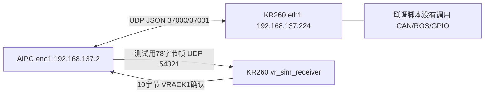
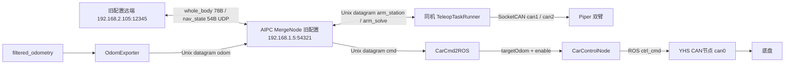

# KR260 USB-CAN 与 AIPC 通信协议栈梳理

核对日期：2026-10-13；用户时区 Asia/Shanghai。本文依据 KR260、AIPC 的实时只读检查和两端源码快照，不修改驱动、业务代码、网络或服务，不发送控制报文、不启动机械臂程序。代码存在、模块可用、历史测试通过、当前服务运行是四种不同状态，以下分别说明。

## 1. 当前结论

1. KR260 已有内核自带 `gs_usb` USB-CAN 驱动，无需为 candleLight 盒子重写 USB 驱动。当前板卡没有插入 USB-CAN，因此没有 `can0/can1/can2` USB 接口，也无法在本次文档工作中验证实际 USB-CAN 收发。
2. 现有 USB-CAN 应用通过 SocketCAN 访问 CAN 网络接口。替换成板载 CAN 时，业务帧格式原则上可复用，但需要接口映射、物理收发器及反馈/故障验证，不能把 `gs_usb` 加载到 FPGA 控制器上。
3. 与 AIPC 相关的现有协议至少分三层：`apex-kr260` JSON/UDP 联调协议；78 字节 `whole_body_msg` / 54 字节 `nav_state_msg` 二进制业务帧；业务帧的 UDP 外部通道与 Unix datagram 本机通道。
4. 当前 AIPC 原业务配置仍指向旧网段、本机 Unix socket；没有直接配置成向 KR260 部署机械臂/底盘控制。KR260 上的 Python 联调程序也没有桥接到 CAN。
5. 原 C++ 协议有已确认的 CRC 覆盖长度错误、忽略校验结果和缺少严格长度检查等问题。本文记录实现现状和待改进项，不将其描述为已完善的生产协议。

## 2. 两端环境与运行快照

| 项目 | KR260 | AIPC |
|---|---|---|
| SSH 地址 | 192.168.137.224 | 192.168.137.2，用户本次明确确认 |
| 有线接口 | eth1，J10D 管理口 | eno1，192.168.137.2/24 |
| 系统/架构 | Ubuntu 24.04.2，aarch64 | Ubuntu 24.04.4，x86_64 |
| 内核 | 6.8.0-1015-xilinx | 7.0.0-38-generic |
| 业务源码 | /home/ubuntu/kr260_link、kr260_setup、piper_dual_arm_teleop | /home/apex/robot_ws |
| USB-CAN 实时枚举 | 未发现 1d50:606f 或对应 CAN netdev | 未发现 1d50:606f 或对应 CAN netdev |
| 当前 CAN 接口 | fpga_can0、fpga_can1、fpga_can2，均 DOWN | 未枚举 CAN 接口 |
| 当前通信业务 | 未看到 udp_link、vr_sim、piper 控制进程及对应 UDP 监听 | 未看到相关 ROS/机械臂/联调进程；docker ps 无运行容器输出 |

AIPC 到 KR260 的实际路由是 `dev eno1 src 192.168.137.2`。`.214` 为早期联调地址，当前不用它。AIPC 的 Wi-Fi 地址 192.168.6.206 不是本次有线业务目的地址。

KR260 的 TCP 5006 是 `kria-dashboard` Bokeh 服务，不是本项目控制协议。AIPC 的 HTTP 8091 是文档服务，也不属于机器人控制链路。未发现启动项引用 udp_link/vr_sim/piper/can_bringup，但检查范围不等于系统中绝无任何其他调度方式。

## 3. USB-CAN 驱动与 Linux 分层


### 3.1 内核驱动

板卡 `modinfo gs_usb` 确认：

- 模块文件：`/lib/modules/6.8.0-1015-xilinx/kernel/drivers/net/can/usb/gs_usb.ko.zst`。
- `intree: Y`，依赖 `can-dev`，vermagic 与当前 aarch64 内核匹配。
- 支持设备别名包括 `USB VID:PID = 1d50:606f`。
- `CONFIG_CAN_GS_USB=m`、`CONFIG_CAN=m`、`CONFIG_CAN_RAW=m`、`CONFIG_CAN_DEV=m` 已提供。
- BCM、ISO-TP、J1939 也被内核配置为模块，但现有底盘/机械臂源码使用 CAN_RAW，没有看到使用这些上层传输协议。

本次 lsmod 未显示 gs_usb，因为没有对应 USB 设备；这不意味着驱动缺失。插入匹配设备后可由 USB 模态别名触发加载，或者由已有启动脚本 modprobe。本次没有为枚举而主动加载模块。

驱动 probe 后注册 CAN netdev；设置波特率等参数通过 USB 控制请求送给盒子固件。实际帧通过 USB Bulk 传输，驱动把接收数据转成 SocketCAN skb。USB host frame 的 echo_id 用于区分接收与发送回显/完成，不能把 echo 当作目标执行回执。host frame 格式与 `struct can_frame` 也不是同一结构。[Linux v6.8 gs_usb 源码](https://github.com/torvalds/linux/blob/v6.8/drivers/net/can/usb/gs_usb.c)、[candleLight 固件项目](https://github.com/candle-usb/candleLight_fw)。

### 3.2 用户空间 SocketCAN

现有 C++ 代码以 `socket(PF_CAN, SOCK_RAW, CAN_RAW)` 建 socket，`SIOCGIFINDEX` 查询接口，再 `bind(sockaddr_can)`。经典帧使用 `struct can_frame`，CAN payload 最多 8 字节；整个 Linux 结构占 16 字节，并不是总线上发了 16 字节数据。can_id 包含 EFF/RTR/ERR 标志，业务解析必须正确处理。CAN payload 的字节序由具体设备协议决定。[Linux SocketCAN 文档](https://docs.kernel.org/networking/can.html)。

替换 USB-CAN → FPGA CAN 的 Linux 分层为 `业务程序 → SocketCAN → xilinx_can/ctucanfd → 控制器 → 外接收发器`。USB 驱动、USB 固件不参与这条链路。

### 3.3 固定命名：模板与实际安装规则不一致

| 文件/主机 | 实际内容 | 含义 |
|---|---|---|
| KR260 /home/ubuntu/kr260_setup/99-usb-can.rules | 三路规则，序列号仍是中文占位符；含 KERNELS 匹配模板 | 不能当作已部署的三路固定命名 |
| KR260 /etc/udev/rules.d/99-usb-can.rules | 序列号 `003900435746570F20383839` → can2 | 实际仅有这一条 USB 命名规则；没有 VID/PID 限定 |
| AIPC /etc/udev/rules.d/99-usb-can.rules | 1d50:606f；`003900435746570F20383839` → can0；`0034004A5746570A20383839` → can1 | 两只盒子的实际规则 |
| KR260 /etc/udev/rules.d/70-kr260-fpga-can.rules | ff060000.can → fpga_can0；ff070000.can → fpga_can1；80160000.can → fpga_can2 | 板载 CAN 独立命名，保留 USB 名称空间 |

**同一只序列号 003900… 的盒子在两台机器上名称不同：AIPC 是 can0，KR260 是 can2。** 接口数字不能直接当作物理设备身份；重新插拔后应以序列号、sysfs device 和业务角色共同确认。多只设备未固定时也不能仅靠枚举顺序分配左右臂。

源码约定还存在历史差异：Piper README 写 can0=左臂/can1=右臂，但实际 `deploy.cpp` 和脚本使用 can1=左臂/can2=右臂。KR260 bringup 约定 can0=底盘 500k，can1/can2=左右臂 1M。应以运行程序参数和实际命名规则为准，后续再统一配置；本次未改规则。

### 3.4 启动脚本及边界

`/home/ubuntu/kr260_setup/can_bringup_kr260.sh`：

1. 检查 gs_usb，缺失时尝试 modprobe；失败则提示模块缺失。
2. can0 存在时 down → bitrate 500000 → up。
3. can1/can2 存在时 down → bitrate 1000000 → up。
4. 不存在就跳过，最后打印接口详情。

没有根据序列号再次验证业务角色；没有配置 restart-ms、错误帧订阅或应用层故障恢复；不会处理 fpga_can*。当前未找到把它设置成系统启动服务的相关引用，因此不能声称它已经自动开机执行。

AIPC 的 `launch_all.sh` 另有 can0=500k 启动命令，且包含旧 `/home/cat/robot_ws`、ROS 192.168.1.5 等值；独立 `docker_launch.sh` 使用 `/home/apex/robot_ws:/workspace` 和 host network。不要把这些旧脚本未经核对直接运行。Docker 共享宿主网络时，can* 仍是宿主接口，不是容器创建了新的 USB-CAN 驱动。

## 4. CAN 业务层

### 4.1 YHS 底盘（当前源码位于 AIPC）

源码：`src/car/yhs_can_control/src/yhs_can_control.cpp`，`CanControl::run()` 硬编码绑定 can0。订阅 `/ctrl_cmd`、`/io_cmd`、`/steering_ctrl_cmd`（ROS 名称解析依节点 namespace）；发布 ctrl_fb、io_fb、四轮反馈、BMS、转向及角度反馈。驱动本身不理解这些业务字段。

| 方向 | 源码 can_id | 实际 29-bit ID | 功能 |
|---|---|---|---|
| TX | 0x98C4D1D0 | 0x18C4D1D0 | 速度控制 |
| TX | 0x98C4D2D0 | 0x18C4D2D0 | 转向控制 |
| TX | 0x98C4D7D0 | 0x18C4D7D0 | 底盘 IO 控制 |
| RX | 0x98C4D1EF | 0x18C4D1EF | ctrl_fb |
| RX | 0x98C4D2EF | 0x18C4D2EF | steering_ctrl_fb |
| RX | 0x98C4D6EF | 0x18C4D6EF | 左前轮 lf_wheel_fb |
| RX | 0x98C4D7EF | 0x18C4D7EF | 左后轮 lr_wheel_fb |
| RX | 0x98C4D8EF | 0x18C4D8EF | 右后轮 rr_wheel_fb |
| RX | 0x98C4D9EF | 0x18C4D9EF | 右前轮 rf_wheel_fb |
| RX | 0x98C4DAEF | 0x18C4DAEF | io_fb |
| RX | 0x98C4DCEF/0x98C4DDEF | 去掉 EFF 标志 | BMS 数据/标志 |
| RX | 0x98C4E1EF/0x98C4E2EF | 去掉 EFF 标志 | 前后角度反馈 |

源码 0x80000000 位是 CAN_EFF_FLAG，不是总线 29 位 ID 的一部分。发送帧 DLC=8。

速度控制帧按 nibble 紧凑打包：bit0..3 为 gear；bit4..19 为 X 速度的 int16（代码乘 1000）；bit20..35 为 Z 角速度 int16（乘 100）；bit36..51 为 Y 速度 int16（乘 1000）；bit52..55 为 4-bit 循环计数；byte7 是 byte0..6 的 XOR。反馈按对应倍率解包，并检查 XOR 后发布。单位必须结合 ROS msg 与设备手册确认，不能把不同协议的角速度单位混用。

`sendData()` 周期线程在 run() 中被注释，当前发送主要由 ROS 回调触发；因此不能假定底盘已有独立周期保活或失联零速。底盘代码、配置在 AIPC，KR260 快照里没有完整部署同一 ROS 工作区的证据。

### 4.2 Piper 双臂

KR260 `/home/ubuntu/piper_dual_arm_teleop` Git HEAD：`b7304355233b069232db7f3c3b3e45d6e526d84c`。`src/deploy.cpp` 调用 `ArmHardwareInterface::start("can1", "can2")`，随后规划 20Hz、控制 200Hz。启动 start() 会发送执行器使能命令，所以不是只读诊断程序，本次没有运行。

| 方向 | ID | 源码行为 |
|---|---|---|
| TX | 0x151 | 控制模式：CAN 命令模式；关节位置/MIT/末端位置模式和速率 |
| TX | 0x155、0x156、0x157 | 六关节位置，每帧两个 int32，大端；输入 rad 转成 milli-degree |
| TX | 0x152、0x153、0x154 | 末端位置/姿态分帧，具体单位按 setEndEffectorPose 实现 |
| TX | 0x159 | 夹爪位置 int32（代码乘 1e6）、力矩 int16（乘 1000），大端，byte6 使能；另有清零命令 |
| TX | 0x471 | byte0=7 全部电机；byte1=0x02 使能、0x01 禁用 |
| TX | 0x15A+电机 index | MIT 紧凑控制字段与 nibble XOR；当前普通关节控制未调用该路径 |
| RX | 0x2A1 | 模式、急停、限位、通信异常等状态 |
| RX | 0x251～0x256 | 高速反馈：速度 int16、电流 uint16、位置 int32，大端 |
| RX | 0x261～0x266 | 低速反馈：电压、驱动/电机温度和状态位 |

当前 `setLeft/RightJointControl` 采用关节位置模式，MIT 控制调用被注释。高速反馈实现把 position 除以 1000 直接存入关节位置，发送却明确按 rad→milli-degree 转换；反馈单位需要与厂家协议对照，存在单位不一致的疑点。源码还标注速度缩放尚未确认。

接收线程顺序阻塞 read 左、右 socket，一侧不来帧可能拖住另一侧；socket/ioctl/bind/write 的返回值缺少系统性检查；解析前未严格检查完整帧、DLC 和 CAN ID 标志。start() 中 `sleep(0.1)` 调用整秒 sleep，参数被转为 0，不能产生期望的 100ms 等待。stop() 中禁用电机被注释，不可认为正常退出一定断能。这些是源码观察，未在本次执行器实测。

## 5. AIPC 与 KR260：现有传输及业务拓扑

### 5.1 目前真正部署的联调链路



这是已有程序和历史联调记录；本次实时检查时这些监听没有运行。本次没有重发 ping/data/VR 报文，也没有重做跨机稳定性测试。

### 5.2 原机器人业务链（配置与源码）



`MergeNode.cpp` 实例化 `MergeHandler<ChannelMode::Unix>`：远端通道仍为 UDP，odom/car/arm 通道为本机 Unix datagram。机械臂 `TeleopTaskRunner` 也明确使用 Unix 模式；先前笼统说“二进制 UDP 控制”只说明帧可走 UDP，并不代表机械臂当前直接监听网络。

**Unix socket 无法跨两台机器通信。** 把机械臂程序搬到 KR260 后，仅复制 arm_station/arm_solve 路径不能连到 AIPC；还需新的 UDP 端点/网关和经过校验的消息路由。目前未发现已完成这种桥接的证据。

## 6. JSON/UDP 联调协议 apex-kr260 v1

两端 `kr260_link/udp_link.py` SHA256 均为 `785e036cd5bd6af5752da520650bff739c2450e5d79fb63ee9131e4aac10ba14`。纯 Python 标准库、IPv4 UDP，每个 datagram 为 UTF-8 JSON，上限 1200 字节。

```json
{"protocol":"apex-kr260","version":1,"kind":"data","seq":123,"time_ns":0,"payload":{"text":"hello"}}
```

`time_ns=0` 仅用于展示格式；实际 encode 写发送端 time.time_ns()。

| 字段 | 类型与规则 |
|---|---|
| protocol | 固定字符串 apex-kr260 |
| version | 严格 int，当前 1 |
| kind | ping / pong / data / ack |
| seq | 严格 int，0≤seq<2^32；请求端随机产生 |
| time_ns | 非负 int，发送端墙上时钟 ns |
| payload | JSON object；默认 {} |

decode 要求顶层恰好六字段，不接受多余/缺失字段；编码拒绝 NaN/Infinity。接收 json.loads 本身没有设置 parse_constant 拒绝非标准数值，不能声称接收端对 payload 中 NaN 做了同等校验。

交互：ping→pong，同 seq；data→调用 on_data→成功后 ack，同 seq。回调异常不 ACK；重复 data 会重新 ACK，但不会再次调用 on_data。去重只保存最近 256 个 seq，未使用 session/source port 组合，也没有持久化，因此不是严格 exactly-once。request 默认 timeout=1秒、retries=3，同一请求重用 seq 和原始 datagram；RTT 基于本机 monotonic 的当前尝试，含处理与调度时间，不是端到端电机延迟。

服务按来源 IP 白名单过滤；请求端匹配来源 IP+端口、kind、seq。没有身份认证、加密、业务执行回执或反重放机制，来源 IP 过滤不是认证。

端口约定：AIPC `192.168.137.2:37000`，KR260 `192.168.137.224:37001`。listen 为手工程序，不是常驻 systemd 服务。send 端绑定临时源端口，ACK 回实际源端口，不固定回 37000/37001。

只读定位命令（不会发控制）：

```bash
ss -lunp | grep -E ':37000|:37001|:54321'
sha256sum /home/ubuntu/kr260_link/udp_link.py
```

如要重新联调，使用现有说明中的 listen/ping/send；本次只整理，不替用户自动启动。

## 7. 78 字节 whole_body_msg 业务帧

来源：两端 C++ `WholeBodySender/Receiver` 与 KR260 Python `vr_frame.py`。下面列出当前 x86_64/aarch64 小端主机的实际布局。C++ 使用 memcpy 原生字节序，没有显式网络字节序转换；跨不同端序平台必须另定义。

| 字节偏移 | 长度 | 字段 | 编码 |
|---|---:|---|---|
| 0 | 2 | header | FB FB，即 0xFBFB |
| 2 | 2 | mask | uint16 LE |
| 4 | 4 | cnt | uint32 LE |
| 8 | 8 | time | uint64 LE，ns |
| 16 | 12 | base_pos xyz | 3×float32 LE |
| 28 | 4 | left_hand_pos | 3×10bit，±2.0 |
| 32 | 4 | right_hand_pos | 3×10bit，±2.0 |
| 36 | 4 | base_quat | smallest-three 四元数 |
| 40 | 4 | left_hand_quat | 同上 |
| 44 | 4 | right_hand_quat | 同上 |
| 48 | 4 | base_lin_vel | 3×10bit，±3.0 |
| 52 | 4 | base_ang_vel | 3×10bit，±3.14 |
| 56 | 4 | left_hand_lin_vel | 3×10bit，±5.0 |
| 60 | 4 | right_hand_lin_vel | 3×10bit，±5.0 |
| 64 | 4 | left_hand_ang_vel | 3×10bit，±6.28 |
| 68 | 4 | right_hand_ang_vel | 3×10bit，±6.28 |
| 72 | 4 | left_grip / right_grip | 左高16、右低16，当前量化范围±1 |
| 76 | 2 | CRC-16/KERMIT | 当前错误地只计算前 76 bit |

3D 压缩：`q=round((v+M)/(2M)×1023)`，打包为 `(qx<<20)|(qy<<10)|qz`。位置 M=2 对应约 3.91mm 的量化步长；“零”不一定解码为精确零。原 C++ 没有完整范围/有限值检查，越界不能当作有定义的正常输入。

四元数数组为 x,y,z,w：找绝对值最大分量，将该分量符号统一成正，把余下三项以±1/√2、10bit 量化；最高两位保存最大分量 index；解码用平方根重建。C++ 未充分检查归一化与平方根负值，Python 测试实现增加了部分校验。

坐标约定来自 whole_body_msg.h：base_pos 为全局 FLU；手部位置相对 base、FLU。机械臂程序又应用 position×1.1、head offset=(0.5,0,1.0)、绕 Y 的 π/2 姿态偏移；迁移时不能重复做或漏做变换。

mask 实际消费者：bit15 系统控制；bit14 底盘；bit13 左手；bit12 右手；bit7 位姿同步请求；OdomExporter 用 bit6 标记同步应答。bit11/10/9 的速度有效位来自结构注释，当前 TeleopTaskRunner 未看到按它们执行控制。不能仅因 mask 中有位就说对应功能已实现。

### 7.1 Python VR 联调包装

`vr_sim_sender.py` → UDP 54321 → `vr_sim_receiver.py`。默认发送20Hz、5秒，neutral 或±0.08m small-sine。make_sim_frame 与 encode_sim_frame 强制 mask=0；接收器也拒绝非零 mask。接收器只解码、记录并返回 `ASCII "VRACK1" + uint32_LE(cnt)`，共10字节。这个 ACK 是测试扩展，不是原 C++ 业务协议的一部分。

接收器按来源 IP 过滤，对长度、header、兼容 CRC、部分字段合法性检查；计数差值按 uint32 环绕统计。duplicate_or_old 被统计但仍 accepted/ACK，不能当成严格过期拒绝。发送器不逐帧重传，结束后有约0.8秒 ACK 宽限期。

## 8. 54 字节 nav_state_msg 状态帧

| 偏移 | 长度 | 字段 |
|---|---:|---|
| 0 | 2 | DC DC，0xDCDC |
| 2 | 2 | mask uint16 |
| 4 | 4 | cnt uint32 |
| 8 | 8 | time uint64 |
| 16 | 12 | base_pos xyz float32 |
| 28 | 4 | base_quat 压缩四元数 |
| 32、36 | 各4 | 左关节1～3、4～6，3×10bit，范围±π |
| 40、44 | 各4 | 右关节1～3、4～6，3×10bit，范围±π |
| 48 | 4 | 左右力反馈，2×16bit，默认量化±1 |
| 52 | 2 | CRC-16/KERMIT，当前只计算前52 bit |

TeleopTaskRunner 每20ms生成关节状态约50Hz，但源码将 nav_state_msg 全零初始化，仅填左右关节；cnt/time/base位姿/force 没有在此路径完整填充。MergeHandler 从 arm 状态取结构、OR odom mask、用 odom base_pos/base_quat 覆盖，但没有明确合并各源时间戳及新鲜度，get_local_arm 初值为1。odom 发送当前关闭时，不能假定状态合并反馈会正常产生。

## 9. AIPC 业务路由、配置与启动现状

当前 `/home/apex/robot_ws/src/robot/config/config.yaml`：

| 功能 | 配置端点/路径 | 启用状态或实现 |
|---|---|---|
| 外部业务 UDP | local=192.168.1.5:54321，remote=192.168.2.105:12345 | 旧网段，与本次 AIPC/KR260 地址不匹配 |
| 点云 UDP | local=192.168.1.5:5001，remote=192.168.2.105:5000 | enable_pcd_trans=false |
| 里程计 UDP 备用 | 127.0.0.1:50003 → :50002 | 当前节点使用 Unix，enable_odom_trans=false |
| 里程计 Unix | /tmp/odom_unix_channel_local → /workspace/tmp/odom | 来源 /filtered_odometry |
| 底盘 Unix | /tmp/cmd_unix_channel_local → /workspace/tmp/cmd | CarCmd2ROS 发布 /robot/targetOdom 与状态开关 |
| 机械臂 Unix | /workspace/tmp/arm_station ↔ /workspace/tmp/arm_solve | 两端必须在同一主机/可见文件系统 |
| image 预留 | 127.0.0.1:50008 → :50007 | 仅见配置，不代表编码/传输程序已经接通 |
| 点云文件 | /workspace/export_cloud.bin | enable_bin_save=false |

`CommunicateNode` 和 `MergeNode` 均使用100Hz主循环。CommChannel 默认定时器间隔1000微秒，轮询发送队列；这只是队列轮询频率，不是源消息的实际频率。规划20Hz、控制200Hz、反馈50Hz与VR测试20Hz也不是同一个周期。

`CarControlNode` 从 /filtered_odometry、/robot/targetOdom 和 /state/car_control_enable 获得状态/目标，发布 /ctrl_cmd，再交给 YHS 节点。control_config.yaml 当前 max_v=0.5、max_w=30.0 等是源码配置值，未在本次实车确认单位和效果。

launch_robotpack.launch 中 communicate 和 merge 节点被注释；launch_all.sh 中 robot 容器也被注释。配置里 enable_cmd2ROS=false，但 CarCmd2ROS 的实际 init 未按此开关阻止启动，不能把这个配置值当可靠的运行禁用保证。当前 docker/进程检查没有看到这条业务链在运行。

### 9.1 点云协议补充

源码还有 CloudSender，不应遗漏：header=0xD0FD，长度1356；PointPacket<CompressedPoint,1400> 每包最多84点。序列化字段顺序为 header、id、length、checksum、point span；前面8字节属性及4字节 span长度，后接点数据。每点16字节，顺序 normal(uint32)、color(uint32)、morton_code(uint64)；Morton 编码采用默认0.01m voxel。实际跨平台端序及序列化必须通过 zpp_bits 原实现样例确认，不把 C++ sizeof 整块内存当作协议。

checksum 字段源码注明“no crc now”，本次未见可靠的重传/分片恢复及端到端完整性实现。发送队列容量50；基于点池/增量策略，每10帧触发压包，不能推定每个点云原帧都发一个 UDP 包。当前传输关闭，未与 KR260 点云接收程序联调。这里是现有 AIPC 业务能力清单，不是已经部署的 KR260 数据通道。

## 10. 可靠性与待修复项

| 优先级 | 源码事实/缺口 | 影响与处理建议 |
|---|---|---|
| P0 | WholeBody CRC::CalculateBits(...,76,...)，NavState为52；API参数是 bit 数 | 只保护9.5/6.5字节，不保护绝大多数业务载荷。修复需两端版本化协商；不能单边改后保持“兼容” |
| P0 | CommChannel 调用 Parsers::Process 后忽略 bool 返回值仍 enqueue | CRC失败也可能入队未初始化数据；必须先检查返回值，再入队 |
| P0 | receiver_handler 仅判断 bytes_transferred>0，使用完整1500字节 buffer | 未严格检查帧长，可能读取残留内容；按 parser length 建 span 并拒绝长度不符 |
| P0 | 缺少可靠的业务失联保护、过期/乱序拒绝和独立执行回执 | 收包或ACK不等于动作完成；部署控制前先定义新鲜度与停机策略并验证 |
| P1 | UDP 接收首轮以 remote_endpoint_ 保存 source | 可能覆盖配置的发送目标；用独立接收端点并验证来源，不复用目标变量 |
| P1 | async_send_to 共用 send_buffer_，没有完整的缓冲区生命周期管理 | 队列后续写入可能影响尚未完成发送；需要独立/持有缓冲与完成状态 |
| P1 | 旧 IP、namespace、Unix 路径和 CAN 角色约定不一致 | 必须在明确路由设计后集中配置，不用文件存在代替两端可达 |
| P1 | CAN 接收阻塞、返回值/DLC/错误帧处理不足；sleep(0.1)失效 | 修复 I/O、线程退出和错误恢复；不通过重复启用电机尝试“验证” |
| P1 | Piper 单位、反馈新鲜度、限位校验未充分落实 | checkInvalidJointPosition 当前直接true；需设备协议和机械条件验收 |
| P2 | 编码未限制所有输入值、队列溢出/时钟同步/长期负载未验证 | 校验范围、记录丢弃策略，测完整业务负载；RTT不能直接当单向延迟 |

AIPC robot 和 Piper 内包含独立复制的 inter-process-comm 库；修复时需同时核对各副本，不只改一个头文件。本次仅复制、分析并生成文档，没有修复以上问题。

## 11. 已有测试证据与本次检查边界

| 证据 | 实际结果 | 不能推断 |
|---|---|---|
| 2026-10-12 JSON/UDP，50Hz×300秒历史记录 | 双方向各15000包按时ACK；P99约1.349/1.624ms | 未覆盖相机、建图、CAN或整车负载；不保证长期无丢包 |
| 2026-10-13 VR历史实机记录 | 20Hz×5秒，100发送/100接受/100ACK；mask=0 | 未调用CAN/机械臂；仅一次短测 |
| 历史 C++/Python 对照 | 一组78字节样例逐字节一致 | 未穷举全部浮点值 |
| 本次离线 test_vr_frame.py | 6项测试通过 | 不验证网络、USB、外设或执行器 |
| 本次位翻转实验 | 在 byte28 位置字段翻一位，decode仍接受且位置改变 | 确认兼容CRC不能保护该字段，不证明全部故障模式 |
| 本次板卡/AIPC检查 | SSH正常、源码/模块/规则/监听状态已核对 | 没有插入盒子、启动业务或实际CAN收发 |

上述历史结果引用源码目录中的原记录，不冒充本次重新实测。当前板载 PS CAN 内部回环有此前160帧通过记录；J2 TX/RX直接交叉失败不等于 USB-CAN 驱动有问题。板载引脚完整外部电气收发仍需收发器及接线验证。

## 12. 操作与维护定位

仅检查、不主动发送的常用命令：

```bash
uname -r
lsusb
modinfo gs_usb
lsmod | grep -E 'gs_usb|can_raw|can_dev'
ip -details -statistics link show type can
cat /etc/udev/rules.d/99-usb-can.rules
cat /etc/udev/rules.d/70-kr260-fpga-can.rules  # KR260
ss -lunp
```

接好且确认角色后，可用 `udevadm info -a -p /sys/class/net/<实际接口>` 查来源、序列号，用被动 candump 查看帧。CAN 本身有ACK机制，普通接收接口也可能参与ACK；需要严格无干预监听时，应确认适配器支持并配置 listen-only。不要为了“检查驱动”直接运行 deploy，它会使能电机。

升级或迁移前备份规则、脚本、网络配置、服务与源码，记录串号、bit/XSA哈希及回退路径。将 USB 三路接口映射到 fpga_can* 需要应用层配置改动和完整外部总线验收，不自动复用 can0 数字含义。

建议实施顺序：统一设备身份与角色 → 修复/版本化二进制协议 → 确定 AIPC↔KR260 新路由 → 只做禁用控制的 codec/网络测试 → 被动 CAN反馈 → 受控执行器验收。GPIO功能不替代CAN收发器，也不提供高速CAN软模拟能力。

## 13. 源码快照与索引

全部分析材料保存在 [work/USB_CAN_AIPC_REVIEW_20261013](work/USB_CAN_AIPC_REVIEW_20261013/INDEX.md)。凭据未写入本文。

- [板卡 UDP 联调源码](work/USB_CAN_AIPC_REVIEW_20261013/kr260_link/udp_link.py)
- [VR codec](work/USB_CAN_AIPC_REVIEW_20261013/kr260_link/vr_frame.py)、[VR 历史实机结果](work/USB_CAN_AIPC_REVIEW_20261013/kr260_link/results/2026-10-13-vr-sim.md)
- [板卡 CAN bringup](work/USB_CAN_AIPC_REVIEW_20261013/kr260_setup/can_bringup_kr260.sh)
- [Piper SocketCAN 实现](work/USB_CAN_AIPC_REVIEW_20261013/piper_dual_arm_teleop/src/arm_hardware_interface.cpp)、[部署入口](work/USB_CAN_AIPC_REVIEW_20261013/piper_dual_arm_teleop/src/deploy.cpp)
- [Piper 本机通道与控制任务](work/USB_CAN_AIPC_REVIEW_20261013/piper_dual_arm_teleop/src/teleop_task_runner.cpp)
- [AIPC 业务配置](work/USB_CAN_AIPC_REVIEW_20261013/aipc/src/robot/config/config.yaml)、[MergeHandler](work/USB_CAN_AIPC_REVIEW_20261013/aipc/src/robot/include/communicate/MergeHandler.hpp)
- [AIPC CommChannel](work/USB_CAN_AIPC_REVIEW_20261013/aipc/src/robot/inter-process-comm/comm_channel.hpp)
- [WholeBodySender](work/USB_CAN_AIPC_REVIEW_20261013/aipc/src/robot/inter-process-comm/msgs/whole_body_msg/whole_body_sender.hpp)、[NavStateSender](work/USB_CAN_AIPC_REVIEW_20261013/aipc/src/robot/inter-process-comm/msgs/nav_state_msg/nav_state_sender.hpp)
- [CRC API](work/USB_CAN_AIPC_REVIEW_20261013/aipc/src/robot/inter-process-comm/msgs/CRC.h)、[压缩编码](work/USB_CAN_AIPC_REVIEW_20261013/aipc/src/robot/inter-process-comm/msgs/compress_utils.hpp)
- [底盘 CAN](work/USB_CAN_AIPC_REVIEW_20261013/aipc/src/car/yhs_can_control/src/yhs_can_control.cpp)
- [旧 USB-CAN 外置驱动源码](work/USB_CAN_AIPC_REVIEW_20261013/aipc/usb_can_driver/gs_usb/gs_usb.c)：目录里存在不代表已安装；两端 modinfo 指向当前内核自带模块。
- [本次离线 codec 验证](work/USB_CAN_AIPC_REVIEW_20261013/codec-observation.json)、[源码 SHA256](work/USB_CAN_AIPC_REVIEW_20261013/source-sha256.json)
- [两端实时配置检查记录](work/USB_CAN_AIPC_REVIEW_20261013/LIVE_CONFIGURATION.md)

板卡源包 SHA256：`ec195b5b9d11be349f6a0323faf2f53eb4559c377b15c0e4f8d4cf6f3a1349b3`；原 AIPC 源包包含部分非源码资源，本地只解出112个筛选后的源码/配置文件。关键 AIPC 文件与远端 SHA256 已核对一致。Piper 协议 XLSX 已归档但本次帧表依据实际 C++ 实现，不声称已对厂家手册每项单位完成验证。
